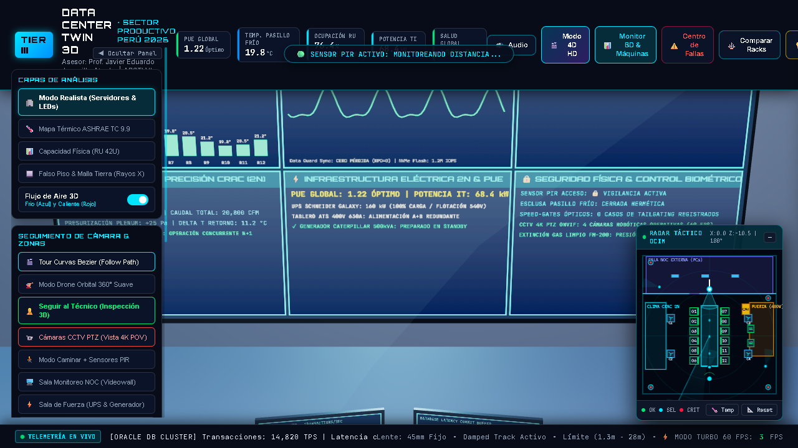
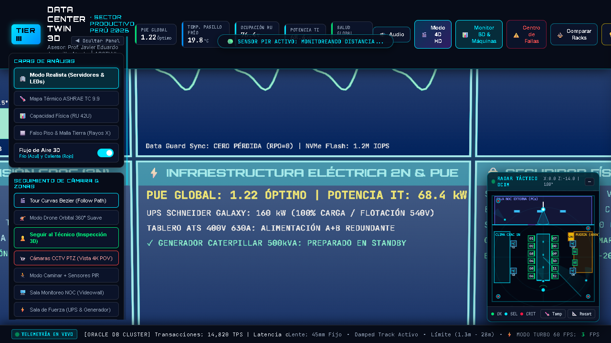
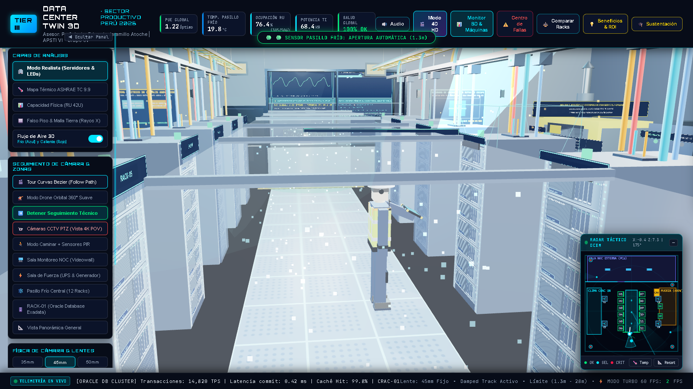
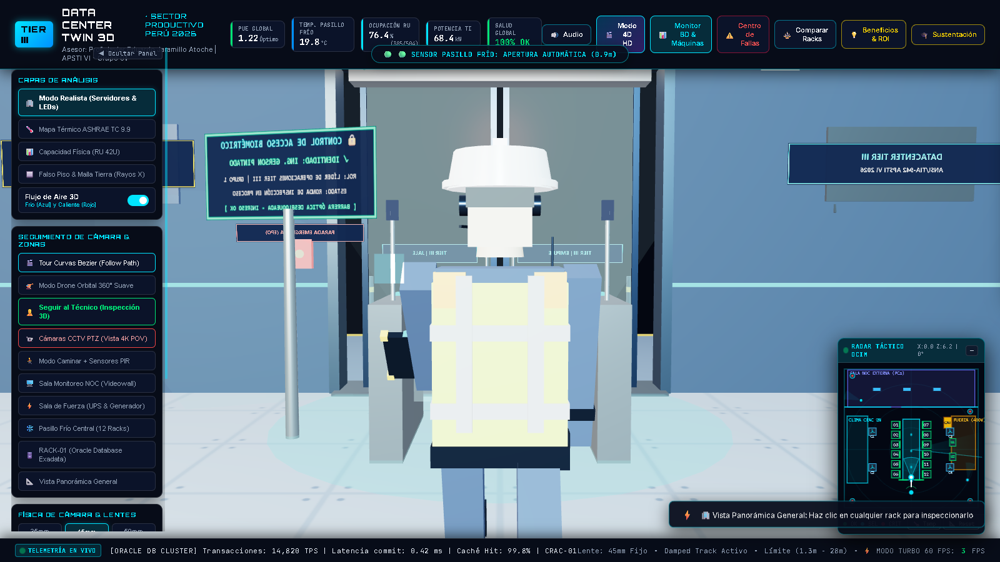
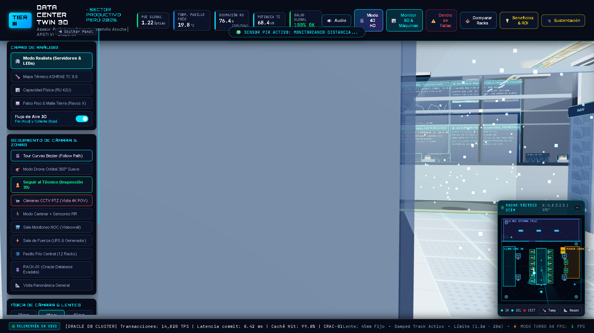
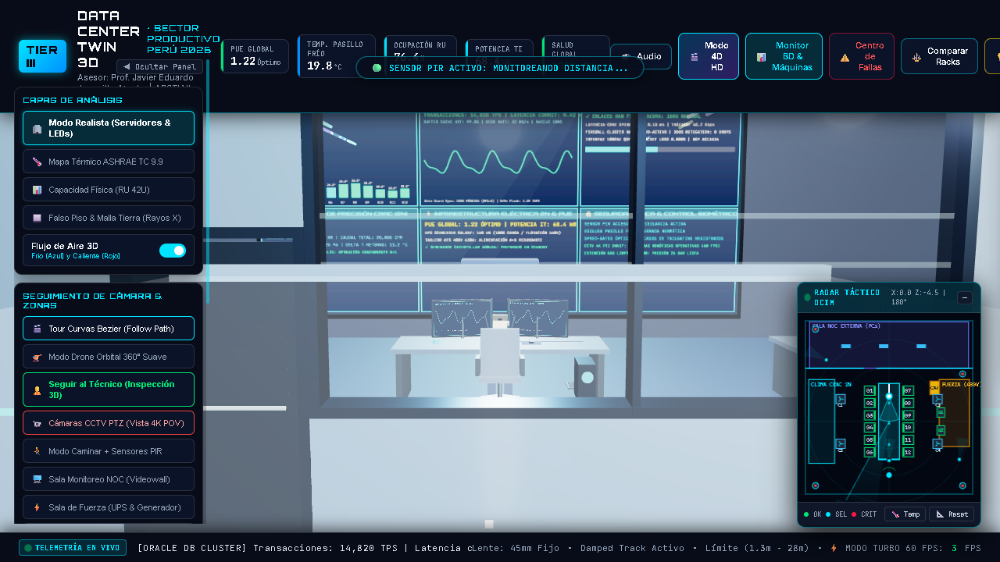
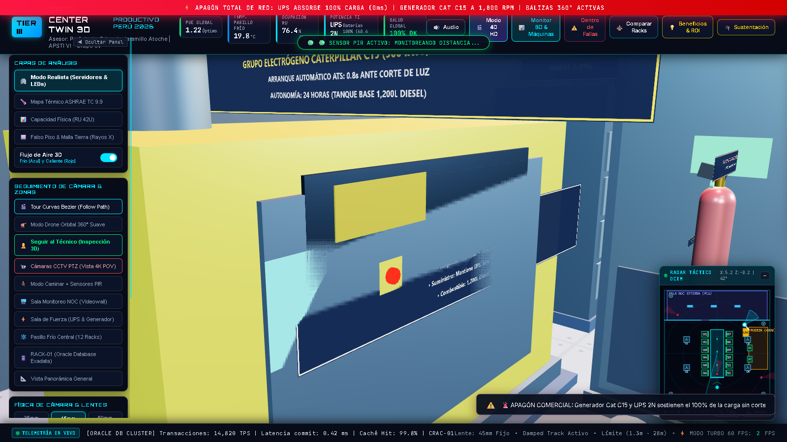

# 🏢 DATA CENTER TWIN 3D · SECTOR PRODUCTIVO PERÚ 2026
### *Gemelo Digital 3D / 4D Interactivo de Centro de Datos Tier III (ANSI/TIA-942 & ISO 27001)*

[](https://threejs.org/)
[](https://developer.mozilla.org/en-US/docs/Web/API/WebGL_API)
[](https://tiaonline.org/)
[](https://www.iso.org/isoiec-27001-information-security.html)
[](https://www.senati.edu.pe/)
[](https://gmph2007.github.io/datacenter-3d-sector-productivo-peru-2026/)

---

## 🌐 DEMOSTRACIÓN EN VIVO (WEBGL DIRECTO)
👉 **Acceso directo al Simulador 3D en el navegador:**  
### **[https://gmph2007.github.io/datacenter-3d-sector-productivo-peru-2026/](https://gmph2007.github.io/datacenter-3d-sector-productivo-peru-2026/)**

*(Compatible con Chrome, Edge, Firefox, Opera y Safari sin necesidad de instalar plugins ni dependencias externas)*.

---

## 📌 FICHA TÉCNICA DEL PROYECTO ACADÉMICO

* **Denominación del Proyecto:** «Diseño Interactivo 3D para la Gestión Eficiente en Espacios de Servidores para Empresas del Sector Productivo, Perú 2026»
* **Programa de Estudios:** Arquitectura de Plataformas y Servicios de Tecnologías de la Información (APSTI VI - 2026)
* **Docente Asesor:** **Prof. Javier Eduardo Jaramillo Atoche**
* **Líder de Proyecto & Desarrollador Principal:** **Gerson Misael Pintado Huamán** (Grupo 01)
* **Enfoque de Negocio:** Optimización operativa, reducción de PUE energético, simulación de contingencias en tiempo real y gemelo digital interactivo para la industria pesquera, agroindustrial y minera del Perú.

---

## 📸 GALERÍA VISUAL DE ALTA DEFINICIÓN (SHOWCASE 3D)

### 1. Sala NOC de Operaciones 24/7 y Puestos de Trabajo Ergonómicos
> Estaciones de trabajo separadas con 2.4 metros de pasillo libre, monitores curvos 32" con telemetría viva, cableado estructurado bajo mesa con pasacables y organizadores espirales, y operadores con postura ergonómica natural.



### 2. Videowall 8K Ultra-Nítido con Mipmaps y Cero Moiré
> Pantalla de control panorámica de 9.4m x 4.2m con emisión directa sin niebla, filtrado anisotrópico 16x y visualización en tiempo real de temperatura ASHRAE, clúster Oracle Exadata RAC, enlaces BGP, climatización CRAC y seguridad biométrica.



### 3. Técnico Autónomo de Inspección con Escáner LiDAR 3D
> Avatar técnico modelado al detalle con uniforme oficial SENATI, chaleco reflectivo Clase 2, casco industrial con linterna LED, arnés táctico y haz de barrido volumétrico LiDAR con retícula de telemetría AR flotante.




### 4. Servidores Empresariales con Actividad de Almacenamiento NVMe
> 12 racks Tier III con chasis empresariales (Dell PowerEdge R750, HPE ProLiant DL380 Gen10+, Oracle Exadata X9M, Cisco Catalyst, PureStorage FlashArray) con matriz de LEDs parpadeantes de lectura/escritura a 15 Hz.



### 5. Visor de Luna y Muro Acústico sin Obstrucciones
> Gran visor panorámico de luna con cristal templado de seguridad y bandas esmeriladas. Se reubicó la red matriz de extinción FM-200 pegada al cielo raso (Y = 5.14m), garantizando una línea visual 100% limpia entre el Datacenter y el NOC.



### 6. Infraestructura Eléctrica 2N y Simulación de Apagón
> Banco de UPS Schneider Galaxy VX de 160 kW, generador Caterpillar C15 de 500 kVA con chimenea de escape al exterior, tablero de transferencia automática (ATS) 400V 630A y conmutación en 0 ms con iluminación de emergencia roja estroboscópica.



---

## 🚀 CARACTERÍSTICAS TÉCNICAS DESTACADAS

```mermaid
graph TD
    A[Data Center Twin 3D] --> B[Arquitectura TI Tier III]
    A --> C[Climatización de Precisión 2N]
    A --> D[Infraestructura Eléctrica 2N]
    A --> E[Seguridad Física & Lógica]
    A --> F[NOC & Telemetría en Vivo]

    B --> B1[12 Racks 42U Confinados]
    B --> B2[Oracle Exadata X9M + Dell R750]
    B --> B3[Red Spine-Leaf Cisco Nexus 100G]

    C --> C1[4x CRAC Liebert 20,800 CFM]
    C --> C2[Pasillo Frío Confinado 19.8°C]
    C --> C3[ASHRAE TC 9.9 Thermal Map]

    D --> D1[Electroductos Canalis 400V A+B]
    D --> D2[UPS Schneider Galaxy VX 160kW]
    D --> D3[Generador CAT 500kVA ATS 630A]

    E --> E1[CCTV PTZ 4K Robotizado POV]
    E --> E2[Control Biométrico de Acceso]
    E --> E3[Gas Limpio FM-200 & VESDA]

    F --> F1[Videowall Panorámico 8K]
    F --> F2[3 Puestos de Monitoreo Ergonómicos]
    F --> F3[Técnico Autónomo con LiDAR]
```



---

## 🎮 CONTROLES DE NAVEGACIÓN Y TECLADO

| Control / Tecla | Acción en el Simulador 3D |
| :--- | :--- |
| **Clic Izquierdo + Arrastrar** | Rotación orbital 360° de cámara (*OrbitControls*) |
| **Clic Derecho + Arrastrar** | Desplazamiento horizontal y vertical (*Pan*) |
| **Rueda del Ratón** | Zoom in / Zoom out suave |
| **Clic en Cámaras Domo** | POV en primera persona de la cámara CCTV robótica |
| **Clic en Racks 01 a 12** | Abre el panel técnico lateral con especificaciones del chasis |
| **W, A, S, D / Flechas** | Desplazamiento en **Modo Caminar** en primera persona |
| **Tecla Espacio** | Abrir / Cerrar compuerta hermética del pasillo frío |
| **Tecla Escape (Esc)** | Salir del modo CCTV o cerrar modales activos |

---

## 📊 CENTRO DE FALLAS E INYECCIÓN DE CONTINGENCIAS

El gemelo digital cuenta con un simulador de contingencias en tiempo real mediante el botón superior **`⚠️ Centro de Fallas`**:
1. **🔥 Sobrecalentamiento Térmico:** Falla en compresores CRAC, elevando la temperatura a 68°C y tornando los mapas térmicos a rojo crítico.
2. **🌐 Corte de Proveedor ISP:** Caída del enlace BGP secundario y conmutación automática de la red Core Spine-Leaf.
3. **❄️ Parada de Emergencia CRAC:** Desconexión de unidades de climatización perimetral y aumento de presión en el pleno.
4. **⚡ Apagón Eléctrico General:** Corte de red pública comercial, conmutación instantánea a UPS Schneider y arranque del generador Caterpillar en 8.4 segundos con luces rojas estroboscópicas.
5. **🛡️ Restablecimiento Total:** Retorno del Datacenter al estado 100% nominal (PUE = 1.22).

---

## 📁 ESTRUCTURA DEL REPOSITORIO

```plaintext
├── index.html                           # Aplicación WebGL Three.js completa (Autocontenida)
├── README.md                            # Documentación y presentación del proyecto
├── GUIA_DE_SUSTENTACION_GRUPO_1.md      # Guía maestra de sustentación académica ante jurado
├── Caso_Practico_Proyecto_Final_Grupo_1.docx # Documento de sustentación técnica institucional
├── INICIAR_PROYECTO_3D.bat              # Script de ejecución local para Windows
├── .gitignore                           # Exclusión de temporales y archivos de compilación
└── screenshots/                         # Capturas de alta definición del entorno 3D
    ├── snap_noc_wide_clean.png
    ├── snap_videowall_no_moire.png
    ├── snap_operator_ergonomic_cabling.png
    ├── snap_gerson_scanning_active.png
    ├── snap_gerson_character_front.png
    ├── snap_servers_living_leds.png
    ├── snap_door_clear_no_pipe.png
    ├── snap_power_blackout_perfect.png
    ├── snap_crac_bay_clean.png
    └── snap_server_room_reorganized.png
```

---

## 👥 CRÉDITOS & AGRADECIMIENTOS

* **Líder de Proyecto:** Gerson Misael Pintado Huamán — *Líder técnico, diseño 3D y programación WebGL*
* **Equipo de Trabajo:** Grupo 01 — *APSTI VI 2026*
* **Docente Asesor:** Prof. Javier Eduardo Jaramillo Atoche
* **Institución:** Servicio Nacional de Adiestramiento en Trabajo Industrial (SENATI)
* **Licencia:** MIT License (Código abierto para fines educativos y profesionales).
